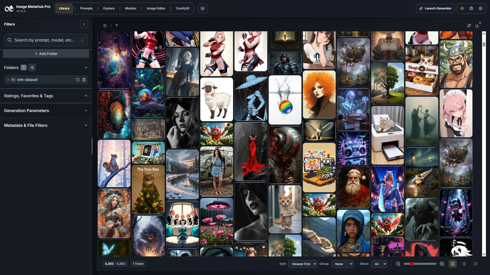
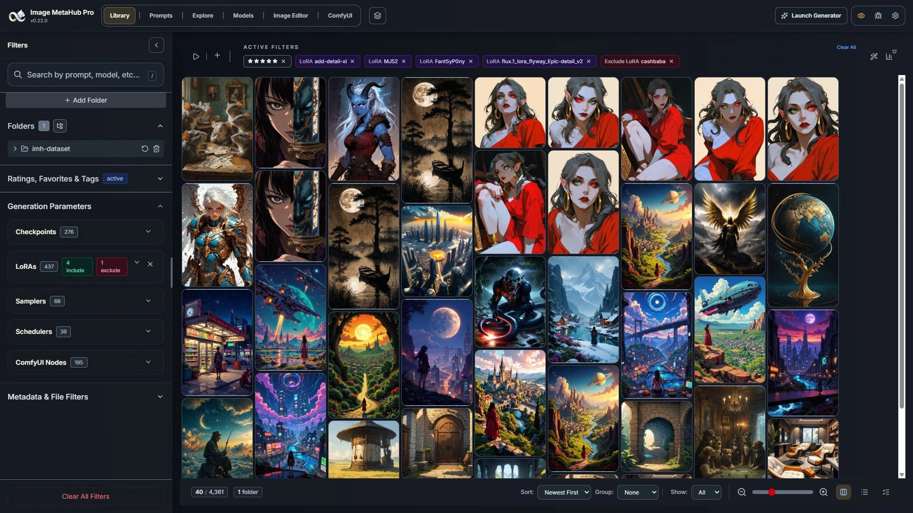
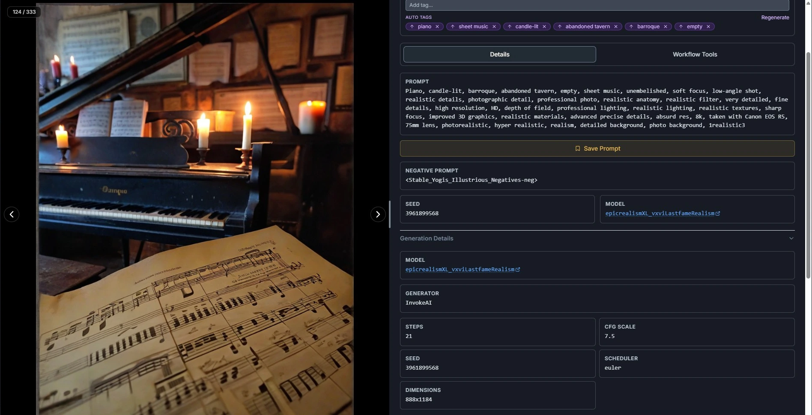
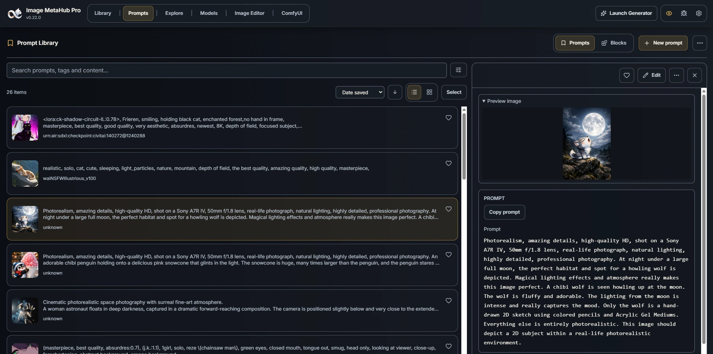
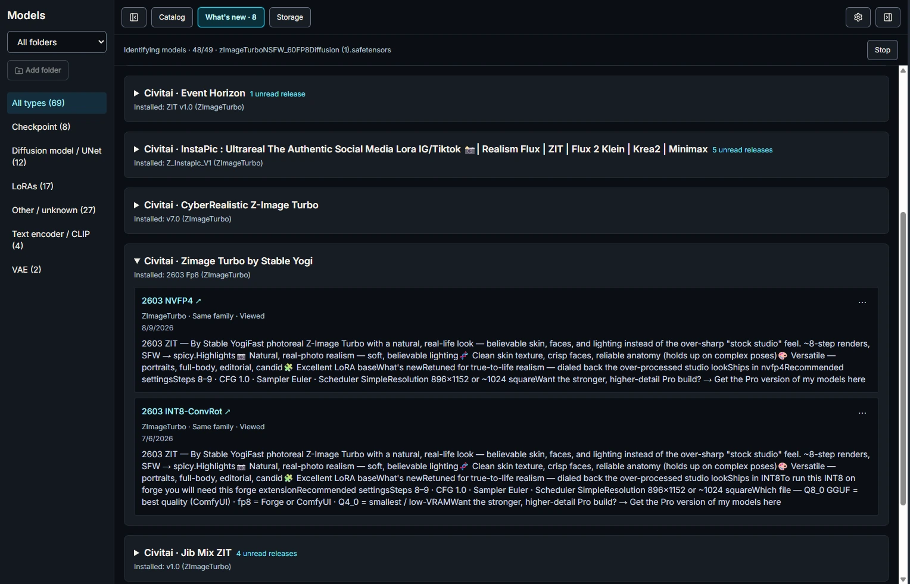
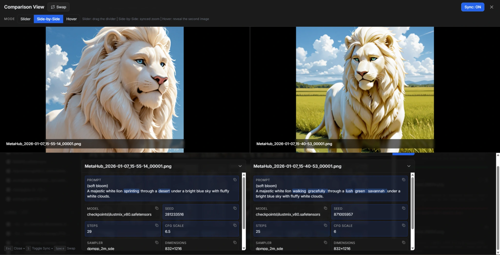
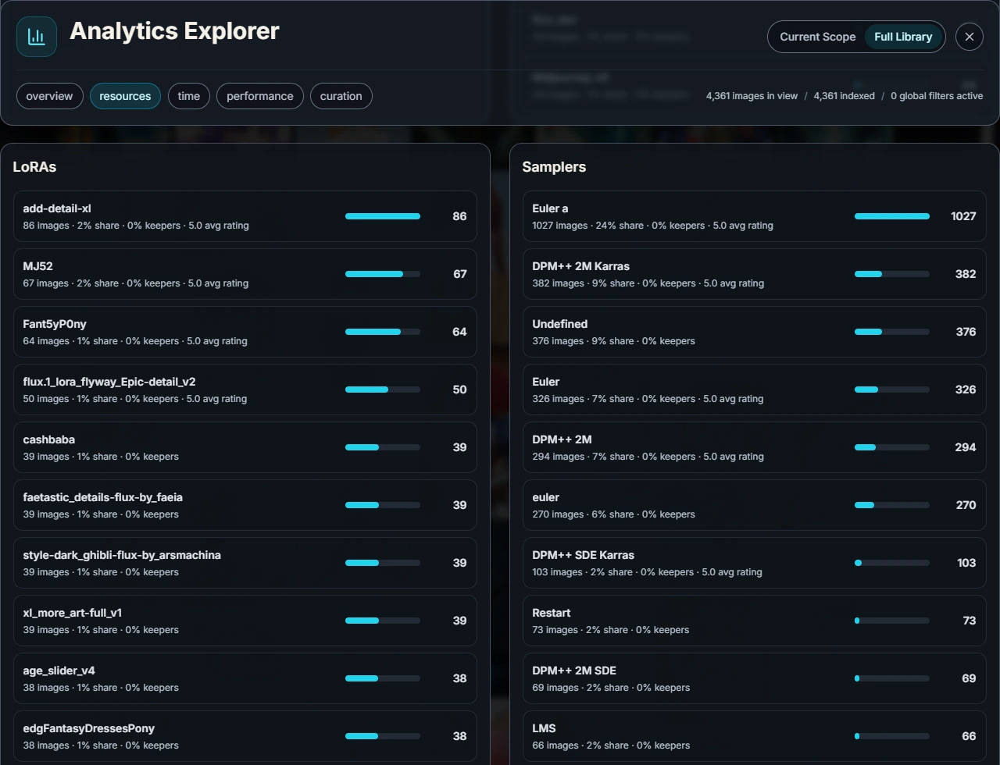
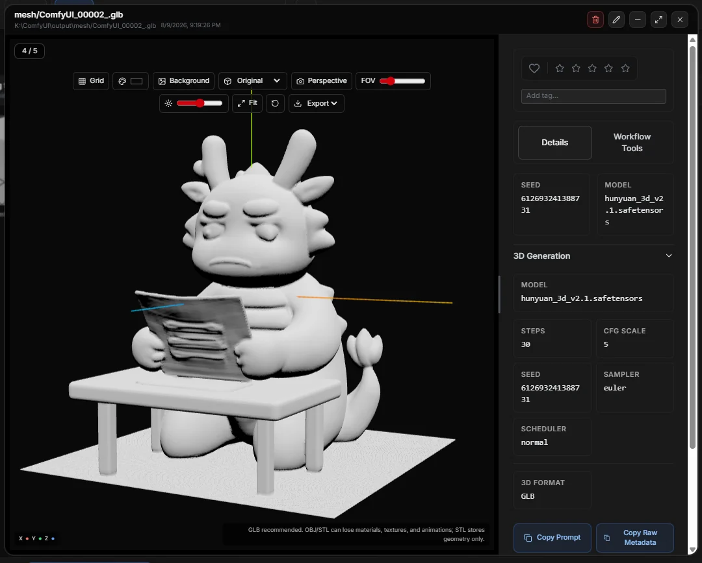

# Image MetaHub

**Find, organize, and reuse your AI generations — all on your own machine.**

Image MetaHub turns your output folders into a searchable desktop library. Find an image by its prompt, model, LoRA, or visual similarity; save prompts for later; and continue working in ComfyUI or Automatic1111. Your files stay where they are, with no uploads or account required.

**[Download the app](https://github.com/LuqP2/Image-MetaHub/releases/latest)** · [Website](https://www.imagemetahub.com?src=readme) · [Get Pro](https://www.imagemetahub.com/pro?src=readme) · [Discord](https://discord.gg/2MXWxjKyJ5)



## Get started

1. Download the build for your system from [GitHub Releases](https://github.com/LuqP2/Image-MetaHub/releases/latest).
2. Open Image MetaHub and add your generation folders.
3. Let the first scan finish, then browse, search, and filter your library.

There is no need to move your files or change your folder structure. Enable folder watching to keep the library updated as new generations arrive.

**Windows:** choose Setup for a standard installation or Portable to keep the app's settings and data beside the executable. When updating Portable, replace only the executable and keep its `ImageMetaHubData` folder.

**macOS:** current builds are unsigned. If macOS blocks the app after you move it to Applications, run this in Terminal:

```bash
xattr -dr com.apple.quarantine "/Applications/Image MetaHub.app"
```

## Find the generation you had in mind

Search prompts and metadata, then narrow the results by checkpoint, LoRA, sampler, tags, rating, folder, media type, or ComfyUI node. Include what you want and exclude what you don't; active filters stay visible above the results.

Browse in grid, Masonry, or table view. Use favorites, ratings, manual tags, and Auto-Tag to keep useful work easy to find. Explore groups images into models, prompt clusters, and collections, while stacks and duplicate helpers make large batches easier to curate. Themes include Ayu, Ayu Light, and additional choices in Settings.

**Find Similar** searches for visually related images, including files with no generation metadata. It runs locally after a separate, explicit model download, with pausable indexing and optional GPU acceleration. Text-to-image visual queries are also available as an experimental option.



## Inspect an image and recover how it was made

Open an image to read its prompt, model, LoRAs, seed, and other available generation settings. Use a separate viewer window, keep several references open, or reuse a single window as you browse.

For related generations, lineage can show source images and transformation chains such as img2img, inpaint, and outpaint. Provenance summarizes available source evidence and offers an optional SHA-256 fingerprint. Shadow metadata lets you edit information while keeping the original available to restore.



## Keep your best prompts ready to reuse

Save a prompt from any image into **Prompt Library**, then search, favorite, copy, or return to its source. **Find images** takes you back to library images matching a saved prompt or block. Import and export through JSON or `styles.csv` to move your prompts between tools.

With Pro, turn useful fragments into reusable **blocks**, compose positive and negative prompts, and create **templates** with fillable fields. Saved compositions keep their own block snapshots, so later edits to a block won't silently change your earlier work.



## Manage your local AI models · Pro

The **Models** workspace organizes checkpoints, LoRAs, diffusion models, VAEs, text encoders, and other local model files with covers, tags, favorites, notes, and trigger words.

Identify versions through Civitai, link files to Hugging Face, and follow new releases or file changes in **What's new**. Both services have independent, optional monitoring controls. Checks retrieve information without downloading or replacing your model weights.

See which library images use a model, inspect it in a detached window, or open **Storage** to review file sizes, locations, and verified duplicate copies. File removal lets you review the selected paths before moving them to the system Trash.



## Continue creating in ComfyUI or Automatic1111 · Pro

Open **ComfyUI Workspace** to work with a running local ComfyUI instance inside the app, alongside your library images, saved prompts, blocks, and models. Reuse prompt text in compatible node fields or save selected node text for later.

Generate from a compatible original workflow or rebuild a simpler workflow from image metadata. Inspect nodes, adjust parameters, and follow queued jobs with live previews. Automatic1111 integration also lets you copy generation parameters or send a generation directly to its API.

Connect your running generator in Settings. For richer ComfyUI outputs, the companion [MetaHub Save Node](https://github.com/LuqP2/ImageMetaHub-ComfyUI-Save) preserves workflow metadata, tags, notes, and available performance metrics. Generation requires the appropriate models and nodes in your generator.

## Compare, edit, and understand your results · Pro

Compare up to **four images**, with synchronized zoom and metadata differences. Two-image modes include a slider, flicker, loupe, difference map, and edge comparison.

The built-in **Image Editor** provides adjustments, crop, rotation, resizing, sharpening, and annotations, with metadata-preserving exports.



**Analytics Explorer** shows which models, LoRAs, samplers, and generators you use, across the full library or current results. Images with MetaHub Save Node telemetry can also contribute generation-time, speed, GPU, and VRAM metrics.



## Images, video, audio, and 3D in one library

Image MetaHub reads generation metadata from ComfyUI, Automatic1111, InvokeAI, Forge, SD.Next, SwarmUI, Fooocus, Draw Things, Midjourney/Niji, Firefly, DreamStudio, DALL-E, and other compatible exports. Available details depend on what the source tool saved.

| Media | Supported formats |
| --- | --- |
| Images | PNG, JPG/JPEG, WEBP, AVIF, GIF |
| Video | MP4, WEBM, MKV, MOV, AVI |
| Audio | MP3, WAV, FLAC, OGG/OGA, M4A, AAC, OPUS, AIFF/AIF, WMA |
| 3D | GLB, GLTF, OBJ, FBX, STL |

Browse and play media, or inspect 3D assets in the interactive viewer and export them. Audio/video playback depends on the codecs available on your system. Files without generation metadata can still be browsed and organized.



## Free and Pro

The core library is free to use. Pro adds generation, model management, and more tools for larger workflows. A **7-day Pro trial** is available on eligible desktop installations.

| Feature | Free | Pro |
| --- | --- | --- |
| Local browsing, metadata search, filters, tags, ratings, and favorites | Included | Included |
| Folder watching, viewer windows, lineage, and shadow metadata | Included | Included |
| Basic Prompt Library, import/export, and exact prompt duplicate detection | Included | Included |
| Local Visual Search indexing | 2,000 newest images | Unlimited |
| Prompt clustering | Limited scale | Unlimited |
| Prompt block creation, composition, and template editing | — | Included |
| Model Manager and model update tracking | — | Included |
| ComfyUI Workspace and Automatic1111 integration | — | Included |
| Image Editor, Compare, and Analytics | — | Included |
| Batch export, bulk tagging, and in-app file copy/move | — | Included |

If Pro or a trial expires, existing prompt blocks and templates remain readable, fillable, copyable, and exportable.

[See Pro plans](https://www.imagemetahub.com/pro?src=readme)

## Privacy

Your library, prompts, tags, and metadata stay on your machine. Browsing and indexing work locally, with no cloud sync or outbound telemetry. Local Visual Search also works offline after its optional model is downloaded.

Network access is used for updates, services you connect to, and optional actions such as Civitai/Hugging Face lookups, model monitoring, and downloads. Pro licenses are verified locally.

## Help and development

Join [Discord](https://discord.gg/2MXWxjKyJ5) for questions, metadata parsing help, and feature requests, or report a bug through [GitHub Issues](https://github.com/LuqP2/Image-MetaHub/issues). See the [changelog](CHANGELOG.md) for release history.

To run the desktop app from source:

```bash
npm install
npm run dev:app
```

Developer references: [Architecture](ARCHITECTURE.md) · [CLI](docs/CLI-README.md) · [Prompt Library](docs/PROMPT_LIBRARY.md) · [ComfyUI context tools](docs/COMFYUI_CONTEXT_TOOLS.md) · [Release guide](docs/RELEASE-GUIDE.md)

Built and maintained by **Lucas (LuqP2)** with community feedback and contributions.

## License

Image MetaHub is **source-available** under the [PolyForm Perimeter License 1.0.1](LICENSE), which permits use, modification, and redistribution for permitted purposes while prohibiting competing products. See [LICENSING.md](LICENSING.md) for details.
